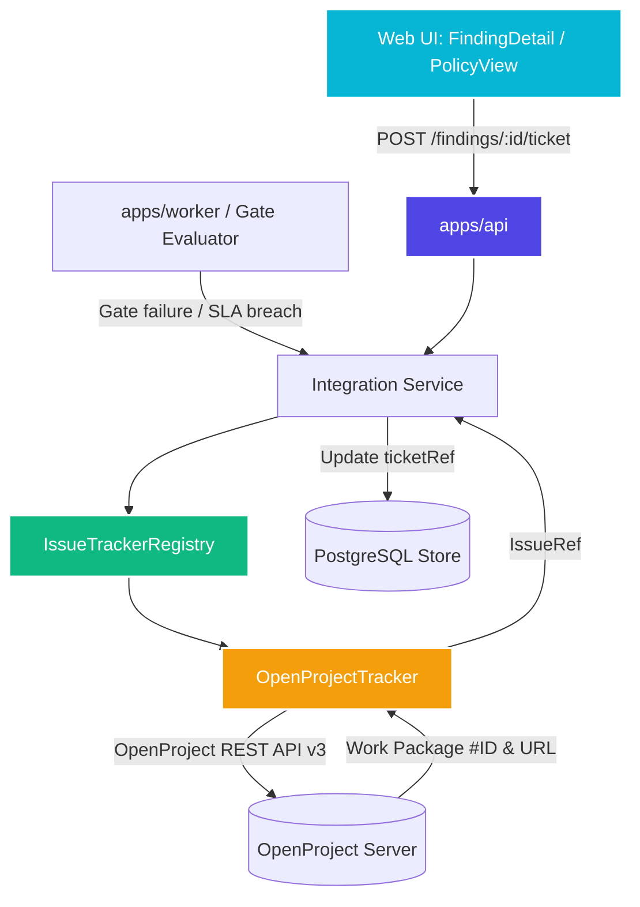

# Plan: Modular OpenProject Integration (`@sdap/integrations`)

## TL;DR
Build a modular issue tracker integration workspace package (`packages/integrations` / `@sdap/integrations`) starting with a fully functional OpenProject API v3 client, anti-halusinasi structured description generator, and two-way linkage. Implement hybrid trigger support: manual export from Finding Detail in Web/API, plus automated Work Package creation on CI release gate failures or SLA breaches.

---

## Objective
Provide an extensible, enterprise-grade issue tracking architecture for SecDevOps Audit Platform (SDAP), with first-class support for OpenProject (`openproject.pengadaan.com`):
1. **Modular Provider Architecture**: Define a generic `IssueTracker` interface supporting future trackers (Jira, GitLab Issues, GitHub Issues) alongside OpenProject.
2. **OpenProject v3 Adapter**: Full REST API v3 implementation with basic auth (`apikey:<token>`) or bearer tokens, type/priority resolution, work package creation, and idempotent activity comments (never destructive description overwrites).
3. **Structured Anti-Halusinasi Documentation**: Generate standardized markdown containing attack class, CWE, location, reproduction steps / exploit trace, verification evidence, remediation draft, and platform deep links.
4. **Hybrid Trigger Support**:
   - **Manual**: Auditor/developer triggers "Create OpenProject Work Package" via API or UI button on confirmed findings.
   - **Automated**: Worker / API service automatically generates/updates Work Packages for blocking violations when a release gate fails or SLA breaches.
5. **Config & Credential Hierarchy**: Global environment fallbacks (`OPENPROJECT_BASE_URL`, `OPENPROJECT_API_KEY`) with optional per-project overrides stored on the `Project` model.
6. **Traceable Finding Linkage**: Findings persist a `ticketRef` (`provider`, `id`, `key`, `url`) rendered in the Web UI as an active external link badge.

---

## Non-Goals
- Full bi-directional status synchronization polling engine (e.g. periodically fetching OpenProject state to auto-close SDAP findings without re-verification) — System 2 verification remains the only authority that transitions findings to `fixed`.
- Importing arbitrary external issues into SDAP as findings.
- Outbound Slack / PagerDuty notification service (kept separated from issue tracker scope).

---

## Decision Summary

| Dimension | Decision | Rationale |
|---|---|---|
| **Packaging** | `packages/integrations` (`@sdap/integrations`) | Monorepo package isolated from core and web; pluggable for future trackers. |
| **Trigger Mechanism** | Hybrid (Manual triage + Automated gate failure/SLA) | Supports developer discretion on specific findings and automatic blockers on CI failures. |
| **Work Package Type** | Configurable per Project (defaults to "Bug") | Adheres to OpenProject squad taxonomy (Bug for vulnerabilities, TechDebt/Task if specified). |
| **Credential Hierarchy** | Hybrid (Global defaults + Per-project overrides) | Simplifies single-instance deployments while allowing multi-tenant project keys. |
| **Update Hygiene** | Activities / Comments for updates | Strictly complies with OpenProject Anti-Halusinasi protocol: never overwrite descriptions. |
| **Finding Linkage** | `ticketRef` schema field on `Finding` | Direct traceability from SDAP UI to OpenProject work package URL. |

---

## Architecture & Package Design



### Module Layout
```text
packages/integrations/
├── package.json
├── tsconfig.json
├── tsconfig.build.json
├── vitest.config.ts
├── src/
│   ├── index.ts
│   ├── types.ts              // IssueTracker, IssueRef, CreateIssueOptions, TrackerConfig
│   ├── registry.ts           // IssueTrackerRegistry (pluggable tracker resolver)
│   ├── openproject/
│   │   ├── client.ts         // OpenProject API v3 HTTP client
│   │   ├── tracker.ts        // OpenProjectTracker implementing IssueTracker
│   │   ├── formatter.ts      // Anti-halusinasi markdown formatter
│   │   └── types.ts          // OpenProject API schemas
│   └── errors.ts             // IntegrationError, AuthError, RateLimitError
└── test/
    ├── contract.test.ts      // Generic IssueTracker contract test suite
    ├── openproject.test.ts   // OpenProject client & tracker integration test
    └── formatter.test.ts     // Description & comment formatting tests
```

---

## Dependency Matrix

| Task | Description | Depends on | Blocks | Can Parallelize With |
|---|---|---|---|---|
| **T1** | Scaffold `@sdap/integrations` & contract definitions | None | T2, T3 | None |
| **T2** | OpenProject API v3 client & anti-halusinasi formatter | T1 | T4 | T3 |
| **T3** | Schema updates in `@sdap/core` (`ticketRef`, `ProjectIntegrations`) | T1 | T4, T5 | T2 |
| **T4** | OpenProjectTracker provider implementation & tests | T2, T3 | T5, T6 | None |
| **T5** | API & Store integration (DB schema, manual export & auto-gate trigger) | T3, T4 | T6, T7 | None |
| **T6** | Web UI integration (Finding detail ticket badge & push action) | T5 | T7 | None |
| **T7** | End-to-end verification, contract tests & documentation | T6 | None | None |

---

## Execution Waves

```text
Wave 1: Foundation & Scaffold
- Task 1: Create packages/integrations and define IssueTracker interfaces

Wave 2: Implementation & Schemas (Parallel)
- Task 2: Implement OpenProject v3 client and Anti-Halusinasi markdown formatter
- Task 3: Update @sdap/core contracts with ticketRef and ProjectIntegrations

Wave 3: Tracker Provider & Database
- Task 4: Implement OpenProjectTracker in @sdap/integrations with full test coverage
- Task 5: Integrate tracker in @sdap/api (DB schema, endpoints, gate trigger)

Wave 4: User Interface
- Task 6: Connect Web UI FindingDetail & PolicyView to OpenProject tickets

Wave 5: Verification & Audit
- Task 7: Full suite verification, lint, typecheck, format, and manual QA
```

---

## TODOs

### Task 1: Scaffold `@sdap/integrations` package and define contracts
- [ ] **What to do**:
  - Initialize `packages/integrations` with `package.json`, `tsconfig.json`, `tsconfig.build.json`, `vitest.config.ts`.
  - Define core interfaces in `src/types.ts`:
    - `IssueRef`: `{ provider: string, id: string, key: string, url: string }`
    - `CreateIssueInput`: `{ finding: Finding, project: Project, options?: { type?: string; priority?: string } }`
    - `IssueTracker`: `createIssue(input): Promise<IssueRef>`, `addComment(issueId, comment): Promise<void>`, `getIssue(issueId): Promise<IssueRef>`
  - Implement `IssueTrackerRegistry` in `src/registry.ts`.
- **What not to do**: Do not hardcode OpenProject-specific fields in the generic `IssueTracker` interface.
- **Files**:
  - `packages/integrations/package.json`
  - `packages/integrations/tsconfig.json`
  - `packages/integrations/tsconfig.build.json`
  - `packages/integrations/vitest.config.ts`
  - `packages/integrations/src/index.ts`
  - `packages/integrations/src/types.ts`
  - `packages/integrations/src/registry.ts`
  - `packages/integrations/src/errors.ts`
- **RED Test**: `packages/integrations/test/registry.test.ts` fails before registry and types exist.
- **GREEN Check**: `pnpm --filter @sdap/integrations test` passes.
- **Manual QA**: Run `pnpm --filter @sdap/integrations typecheck`.
- **Commit**: `YES`, `feat(integrations): scaffold package and define IssueTracker contracts`.

---

### Task 2: OpenProject API v3 client & Anti-Halusinasi formatter
- [ ] **What to do**:
  - Implement `OpenProjectClient` in `packages/integrations/src/openproject/client.ts` using native fetch:
    - Authentication: Basic auth (`apikey:<token>`) or Bearer token header.
    - `getProject(identifier)`
    - `getTypes()` / `getPriorities()`
    - `createWorkPackage(projectId, payload)`
    - `addActivity(workPackageId, comment)`
  - Implement `formatOpenProjectDescription` and `formatGateFailureActivity` in `formatter.ts`:
    - Adhere strictly to the anti-halusinasi standard from `openproject-guide.md`:
      - Standard structured layout: Finding metadata, Vulnerability Summary, Exploit Trace / Reproduction Steps, Remediation Draft, SDAP Deep Link.
      - Never overwrite existing descriptions on re-triage or update; use activities/comments.
- **What not to do**: Do not bypass authentication or omit error handling on HTTP non-2xx responses.
- **Files**:
  - `packages/integrations/src/openproject/types.ts`
  - `packages/integrations/src/openproject/client.ts`
  - `packages/integrations/src/openproject/formatter.ts`
  - `packages/integrations/test/formatter.test.ts`
  - `packages/integrations/test/client.test.ts`
- **RED Test**: `packages/integrations/test/formatter.test.ts` asserts expected markdown headings and trace breakdown.
- **GREEN Check**: `pnpm --filter @sdap/integrations test` passes.
- **Manual QA**: Test mock OpenProject API responses against format expectations.
- **Commit**: `YES`, `feat(integrations): implement OpenProject v3 client and anti-halusinasi formatter`.

---

### Task 3: Core contracts update (`@sdap/core`)
- [ ] **What to do**:
  - In `packages/core/src/finding.ts`:
    - Add `TicketRef = z.object({ provider: z.string(), id: z.string(), key: z.string(), url: z.string() })`.
    - Add `ticketRef: TicketRef.nullable().default(null)` to `FindingBase`.
  - In `packages/core/src/project.ts`:
    - Add `ProjectIntegrations` with `openproject` schema (enabled, projectIdentifier, baseUrl, apiKeySecretRef, defaultWorkPackageType).
    - Add `integrations: ProjectIntegrations.default({})` to `Project`.
  - In `packages/core/src/api.ts`:
    - Export `ExportTicketRequest` and `TicketRef`.
  - Export newly added schemas in `packages/core/src/index.ts`.
- **What not to do**: Do not break existing serialized findings or project fixtures.
- **Files**:
  - `packages/core/src/finding.ts`
  - `packages/core/src/project.ts`
  - `packages/core/src/api.ts`
  - `packages/core/src/index.ts`
  - `packages/core/test/contracts.test.ts`
- **RED Test**: `pnpm --filter @sdap/core test` checks `Finding` and `Project` schemas with and without `ticketRef`/`integrations`.
- **GREEN Check**: `pnpm --filter @sdap/core test` passes.
- **Commit**: `YES`, `feat(core): add ticketRef to Finding and integrations to Project`.

---

### Task 4: OpenProjectTracker provider implementation
- [ ] **What to do**:
  - Implement `OpenProjectTracker` implementing `IssueTracker` in `packages/integrations/src/openproject/tracker.ts`.
  - Priority mapping:
    - `critical` -> `Immediate`
    - `high` -> `High`
    - `medium` -> `Normal`
    - `low` -> `Low`
    - `informational` -> `Low`
  - Work package type resolution:
    - Resolves type dynamically or uses project's configured `defaultWorkPackageType` (e.g., "Bug").
  - Idempotent creation:
    - If finding already has an associated `ticketRef`, calls `addActivity` with an update comment instead of creating duplicate work packages.
  - Register `OpenProjectTracker` in default registry.
- **What not to do**: Do not swallow API network errors without converting to typed `IntegrationError`.
- **Files**:
  - `packages/integrations/src/openproject/tracker.ts`
  - `packages/integrations/src/index.ts`
  - `packages/integrations/test/openproject.test.ts`
  - `packages/integrations/test/contract.test.ts`
- **RED Test**: Test `OpenProjectTracker.createIssue()` against mock HTTP server.
- **GREEN Check**: All tests in `packages/integrations` pass.
- **Commit**: `YES`, `feat(integrations): implement OpenProjectTracker provider`.

---

### Task 5: Database schema & API integration (`@sdap/api`)
- [ ] **What to do**:
  - Update `apps/api/src/db/schema.ts`:
    - Add `ticketRef: jsonb("ticket_ref").$type<TicketRef | null>()` to `findings`.
    - Add `integrations: jsonb("integrations").$type<ProjectIntegrations>().notNull().default({})` to `projects`.
  - Update `apps/api/src/db/store.ts` finding set methods to persist `ticketRef`.
  - Add API route `POST /findings/:id/ticket` in `apps/api/src/routes/findings.ts`:
    - Accepts manual export requests from authorized roles (`admin`, `security`, `developer`).
    - Resolves tracker via `@sdap/integrations` registry using project or global config.
    - Creates or updates OpenProject work package and stores `ticketRef` on finding.
    - Emits audit log entry `finding.ticket_exported`.
  - Add automated gate failure integration hook:
    - When `evaluateGate()` returns `pass: false` during CI run completion, if project has `integrations.openproject.enabled` and gate notifications enabled, automatically reports blockers to OpenProject.
- **What not to do**: Do not allow unauthenticated or unauthorized callers to export tickets.
- **Files**:
  - `apps/api/src/db/schema.ts`
  - `apps/api/src/db/store.ts`
  - `apps/api/src/routes/findings.ts`
  - `apps/api/src/run-service.ts`
  - `apps/api/test/contract.test.ts`
  - `apps/api/test/integrations.test.ts`
- **RED Test**: `POST /findings/:id/ticket` integration test verifying ticket creation and audit event.
- **GREEN Check**: `pnpm --filter @sdap/api test` passes.
- **Commit**: `YES`, `feat(api): integrate @sdap/integrations into findings route and gate runner`.

---

### Task 6: Web UI integration (`@sdap/web`)
- [ ] **What to do**:
  - Update `apps/web/src/api/client.ts` and `apps/web/src/api/mock.ts` with `exportTicket(findingId)` endpoint.
  - In `apps/web/src/screens/FindingDetail.tsx`:
    - Display external ticket badge if `finding.ticketRef` exists (`[OpenProject #15167]` with direct link to work package).
    - Add "Push to OpenProject" action button in the triage panel when not yet exported.
  - In `apps/web/src/screens/PolicyView.tsx`:
    - Add OpenProject status card under integrations (indicating global or per-project OpenProject connection status).
- **What not to do**: Never show placeholder or fake dummy links. Only render the ticket badge when `ticketRef` is actually populated.
- **Files**:
  - `apps/web/src/api/client.ts`
  - `apps/web/src/api/mock.ts`
  - `apps/web/src/screens/FindingDetail.tsx`
  - `apps/web/src/screens/PolicyView.tsx`
  - `apps/web/test/screens.test.tsx`
- **RED Test**: Test `FindingDetail` rendering with `ticketRef` and click interaction for export.
- **GREEN Check**: `pnpm --filter @sdap/web test` passes.
- **Commit**: `YES`, `feat(web): add OpenProject ticket badge and export action in finding detail`.

---

## Final Verification Wave

- [ ] **Plan Compliance Audit**: Verify all 7 tasks were completed and no placeholders were introduced.
- [ ] **Monorepo Build**: `pnpm build` across all packages.
- [ ] **Typecheck**: `pnpm typecheck` (zero TypeScript errors).
- [ ] **Lint**: `pnpm lint` (zero ESLint errors).
- [ ] **Test Suite**: `pnpm test` (100% passing across core, integrations, api, worker, web).
- [ ] **Format**: `pnpm format:check` (100% Prettier clean).
- [ ] **Manual QA Verification**:
  1. Create a mock OpenProject endpoint.
  2. Call `POST /findings/:id/ticket` via HTTP.
  3. Verify `ticketRef` is saved on finding.
  4. Verify markdown description complies with OpenProject Anti-Halusinasi format.
  5. Inspect FindingDetail UI in browser at `http://localhost:5173/`.

---

Next: `start-work openproject-integration`
