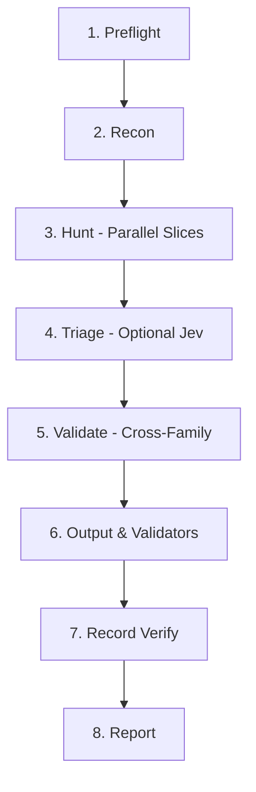

# @sdap/worker

BullMQ audit worker: executes end-to-end security audits using the vendored `security-audit-skill`, parallel slices, model routing with automatic fallback, and validation gates.

Owner: workstream **WS1** (see `docs/workstreams/WS1.md`).

---

## Architecture & Responsibilities

The worker consumes audit run requests from the BullMQ queue (`sdap-runs`) and executes an 8-phase pipeline:

### Pipeline Phases

1. **`preflight`**: Verifies model health (`health()`) across all primary and fallback routes. Executes a harness permission check verifying the target directory is readable and the output directory is writable. Fails fast if any check fails.
2. **`recon`**: Generates `architecture.md` and initializes `coverage-ledger.json`.
3. **`hunt`**: Runs parallel slices partitioned by attack classes or scoped paths. Slices execute via `SandboxRunner` with per-slice fallback chains. Persists slice progress after each state change.
4. **`triage`**: Optional System 1 (Jev) scoring and ranking of candidate leads.
5. **`validate`**: Parallel adversarial verification of candidate leads. **Cross-family requirement**: enforces that the verification model family differs from the hunter model family (e.g., Anthropic hunter verified by Google Argon model) whenever the configured route permits.
6. **`output`**: Assembles final artifacts and runs skill validators (`validate-findings.cjs` and `validate-coverage-ledger.cjs`). Any invalid JSON is automatically moved to `quarantine/` and retried up to `MAX_VALIDATION_RETRIES`. Emits `validator.done` and invokes the injected `importFindings` normalizer hook.
7. **`record_verify`**: Independent verification pass for recorded findings.
8. **`report`**: Produces markdown reports (`REPORT.md`, `FINDINGS-DETAIL.md`, `NEEDS-VALIDATION.md`), tallies final verdict counts (`confirmed`, `needs_validation`, `rejected`), records usage, and emits `run.completed`.

---

## Configuration

Worker settings are parsed from environment variables with Zod (`src/config.ts`):

| Variable                  | Type           | Default                           | Description                                                               |
| ------------------------- | -------------- | --------------------------------- | ------------------------------------------------------------------------- |
| `NODE_ENV`                | enum           | `development`                     | Node environment (`development`, `production`, `test`).                   |
| `LOG_LEVEL`               | enum           | `info`                            | Logging verbosity (`debug`, `info`, `warn`, `error`).                     |
| `REDIS_URL`               | string         | `redis://localhost:6379`          | Redis connection URL for BullMQ and pub/sub events.                       |
| `WORKER_CONCURRENCY`      | number         | `2`                               | Maximum concurrent jobs/slices processed by the worker.                   |
| `MAX_VALIDATION_RETRIES`  | number         | `2`                               | Maximum retry attempts when artifact validation fails before failing run. |
| `SDAP_SKILL_PATH`         | string         | `vendor/security-audit-skill/...` | Absolute path to vendored `security-audit-skill`.                         |
| `DEFAULT_MAX_RUNTIME_SEC` | number         | `14400` (4 hours)                 | Default wall-clock execution limit per run.                               |
| `DEFAULT_TOKEN_BUDGET`    | number \| null | `null`                            | Optional default token budget per run across all phases.                  |
| `SDAP_OUTPUT_BASE_DIR`    | string         | `.sdap/runs`                      | Base filesystem directory for run artifacts and quarantine storage.       |

Budgets are checked continuously between slices. If `tokenBudget` or `maxRuntimeSec` is exceeded, the worker halts new slices and marks the run failed with a clear diagnostic reason.

---

## Routing & Fallback

Each slice resolves model candidates from `ModelRoute`:

- **Primary Model**: First model attempted for the task.
- **Fallbacks**: Ordered fallback list used when `ModelAdapterError.shouldFallBack` is `true` (e.g., `quota_exceeded`, `safety_blocked`, `permission_denied`, `unavailable`).
- **Retries**: For transient errors (`rate_limited`, `timeout`), the slice retries with exponential backoff before falling back.
- **Cross-Family Verification**: In `validate`, if the primary model matches the family of the hunting model (e.g., `claude-opus` and `claude-sonnet` both Anthropic), the router searches `route.fallbacks` for a different family model (e.g., `gemini-4-argon` from Google) and promotes it to the primary verifier.
- **Slice Attempts**: Every attempt is recorded as a `SliceAttempt` with model, duration, status, machine-readable `errorCode`, and token usage.

---

## Resume & Cancellation

- **Resume (`RunJob.resume: true`)**: Slices already in `succeeded` status in `Store.runs.listSlices` are skipped, preventing redundant computation.
- **Cancellation**: Cancellation flags and job abortion are inspected before every phase and between parallel slices. A cancelled run emits `run.cancelled` and transitions to `cancelled`.

---

## Event Streaming

All events conform to `@sdap/core` `PlatformEvent` and are sequenced by `EventSequencer` with strictly monotonically increasing `seq` (0, 1, 2...):

- `run.started`
- `phase.started`, `phase.done`
- `slice.started`, `slice.attempt_failed`, `slice.done`
- `validator.done`
- `finding.upserted`
- `run.completed`, `run.failed`, `run.cancelled`

Events are published to Redis pub/sub channel `sdap:events` (`EVENT_CHANNEL`) and appended to `Store.events`.

---

## Fake Agent CLI (Testing)

Unit tests run in complete network isolation with no external LLM dependencies using a synthetic Node script:

- **Location**: `test/fixtures/fake-agent.cjs`
- **Invocation**: Spawned through the `SandboxRunner` interface by `AgentCliAdapter`.
- **Capabilities**:
  - Outputs canned, valid `findings.json` matching `report-schema.json`.
  - Outputs canned, valid `coverage-ledger.json` matching `validate-coverage-ledger.cjs`.
  - Simulates errors based on model flags or prompts:
    - Quota exceeded (`--model *quota*` / `SIMULATE_QUOTA`) -> exits with code 1 and quota error message.
    - Rate limit (`--model *rate*` / `SIMULATE_RATE_LIMIT`) -> exits with code 1 and 429 status.
    - Safety block (`--model *safety*` / `SIMULATE_SAFETY`) -> exits with code 1 and filter block notice.
    - Permission denied (`--model *permission*` / `SIMULATE_PERMISSION`) -> exits with code 1 and EACCES.
    - Malformed output (`SIMULATE_INVALID_FINDINGS`) -> writes invalid JSON for quarantine verification.

---

## Scripts

- `pnpm build`: compile to `dist/` using TypeScript.
- `pnpm typecheck`: typecheck with strict settings.
- `pnpm lint`: ESLint check across source and test files.
- `pnpm test`: run unit tests via Vitest.
